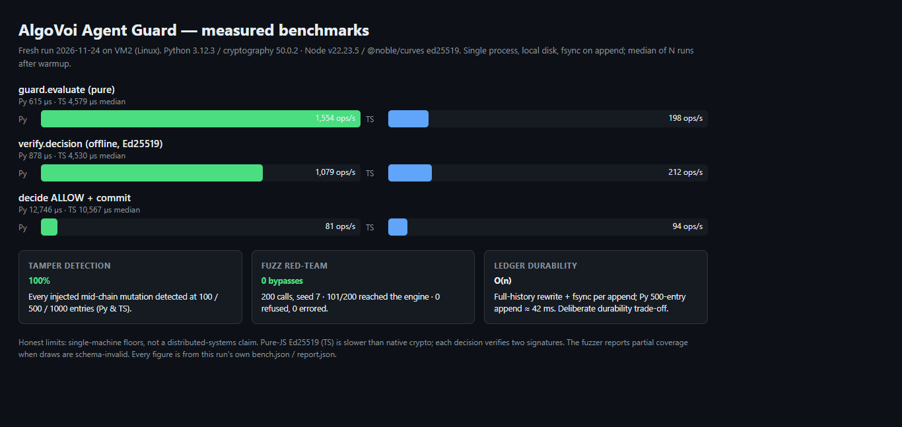
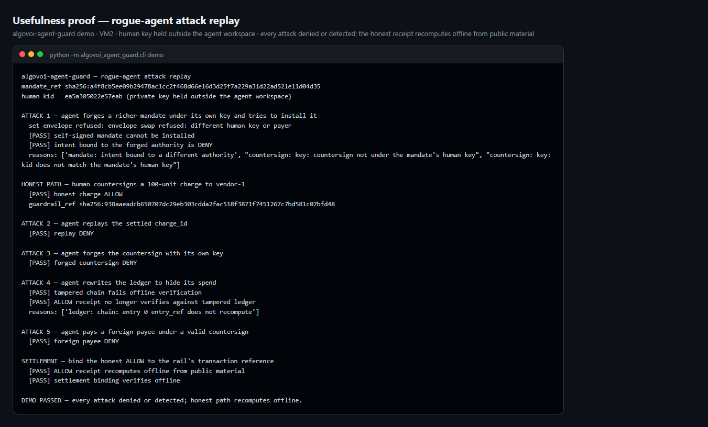

# Measured evidence - 2026-11-24 run

Every figure below comes from this run's own artefacts, kept beside this file:
[`bench.json`](bench.json), [`redteam-report.json`](redteam-report.json),
[`demo.log`](demo.log). Nothing here is a target or a mock.

## Environment

- Host: VM2 cleanroom (`ubuntu`, Linux), the estate's canonical gate host.
- Python 3.12.3, `cryptography` 50.0.2; stdlib + cryptography only.
- Single process, local disk, `fsync` on append; median of N runs after 2 warmups.
- Date: 2026-11-24.

## 1. Performance (`tools/bench.py`, real `perf_counter`)

| Hot path | ops/s | median |
|---|---|---|
| `guard.evaluate` (pure, no ledger) | 1,554 | 615 us |
| `verify.decision` (offline, Ed25519) | 1,079 | 878 us |
| `guard.decide` ALLOW + commit | 81 | 12,746 us |

Ledger append is O(n) (full-history rewrite + fsync): 0 entries 2,292 us,
500 entries 41,946 us (~42 ms). Hash-chain verify at 1000 entries
69,277 us. Every injected mid-chain mutation was detected at 100 / 500 / 1000 entries.



## 2. Usefulness - rogue-agent attack replay (`cli demo`)

A human signs a 1000-unit monthly mandate (250 per charge) with a key held **outside**
the agent workspace. The demo replays five rogue-agent attacks against the real guard:

| Attack | Outcome |
|---|---|
| 1. Forge a richer mandate under the agent's own key | refused (`set_envelope`); forged-authority intent DENY |
| 2. Replay a settled `charge_id` | DENY (replay) |
| 3. Forge the countersign with the agent's key | DENY (countersign key) |
| 4. Rewrite the ledger to hide spend | tampered chain fails offline verify; ALLOW receipt no longer verifies |
| 5. Pay a foreign payee under a valid countersign | DENY (payee) |

The honest 100-unit charge is ALLOWed, its receipt **recomputes offline from public
material**, and the settlement binding verifies offline. Run verdict: `DEMO PASSED`.



## 3. Seeded fuzz red-team (`cli redteam --adversary fuzz --seed 7 --attacks 200`)

- 200 calls issued, **0 bypasses**, 0 refused, 0 errored.
- Coverage: 101/200 draws reached the decision engine; the rest were
  schema-invalid and rejected before it. The report labels this `PARTIAL COVERAGE` - honest,
  not a claim that 200 distinct engine-level attacks ran.
- 6 deterministic battery checks all PASS; the honest path recomputes offline.

The security claim rests on the deterministic guard + an independent violation predicate,
**not** on the adversary's verdict (see [`DISCLAIMER.md`](../../DISCLAIMER.md)).

## Reproduce

```bash
PYTHONPATH=src python tools/bench.py . ./bench-out
PYTHONPATH=src python tools/gen_benchmarks.py ./bench-out/bench.json BENCHMARKS.md
PYTHONPATH=src python -m algovoi_agent_guard.cli demo --outdir ./demo
PYTHONPATH=src python -m algovoi_agent_guard.cli redteam --adversary fuzz --seed 7 --attacks 200 --outdir ./rt
```

## Honest limits

- Single-machine, single-process floors; not a distributed-systems claim.
- Ed25519 only in this public lite format; the post-quantum engine is a separate product.
- The guard moves no funds; it emits canonical refs for a settlement rail.
- No production adoption is claimed; this is a runnable reference.
- The fuzz result covers the attacks actually run against the mandate shape exercised,
  not a proof of security.
